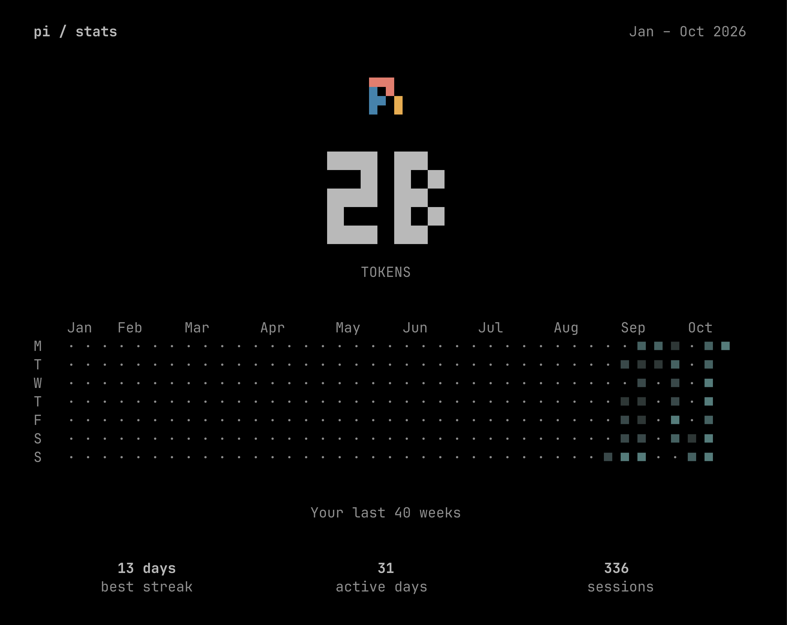

# pi-stats-poster

[](https://www.npmjs.com/package/pi-stats-poster)
[](https://pi.dev/packages/pi-stats-poster)

A year-to-date usage poster for [pi](https://pi.dev), the coding agent: a
block-digit token total, a GitHub-style activity calendar, and your best
streak, active days and session count. Ported from opencode's TUI `/stats`
view (MIT) — see [Credits and licence](#credits-and-licence). Run `/stats` in
interactive mode; `Escape`, `Ctrl+C` (or `q`) closes it.

[](https://www.npmjs.com/package/pi-stats-poster)

*One machine's year to date. The calendar falls back to "Your last N weeks"
when the terminal is too narrow to hold a full year.*

## What it shows

- **The token total** — every model call this year: assistant messages plus
  compaction and branch summaries. Cache reads are counted, which is why the
  number is large. Reasoning tokens already sit inside the output count, so
  they are not added twice.
- **The calendar** — a year of activity, one column per week, five shade
  levels.
- **best streak / active days / sessions** — the longest run of consecutive
  active days, the days with any activity at all, and the sessions that had
  some.

## Install

From npm:

```bash
pi install npm:pi-stats-poster
```

From git, tracking `main`:

```bash
pi install git:github.com/xprnvd/pi-stats
```

Add `@v0.1.7` to the git URL (or `@0.1.7` to the npm spec) to pin a release.
To try it for one invocation without adding it to your settings:

```bash
pi -e npm:pi-stats-poster
```

From a local checkout:

```bash
pi install /absolute/path/to/pi-stats
```

## Requirements

Built and tested against pi 1.3.0 or newer. The poster reads your session
history, so it shows something only once you have used pi.

## Privacy

The extension reads your session files under `~/.pi/agent/sessions` to count
tokens. **Nothing is sent anywhere**: there is no network call, no telemetry
and no external service in this package. The data stays on your machine and in
your terminal.

A per-file cache of the parsed counts is written to
`~/.pi/agent/pi-stats/cache.json`. Delete it any time; it is rebuilt on the
next run.

## Notes

- **`/stats` is also the command of
  [`preinpost/pi-stats`](https://www.npmjs.com/package/pi-stats)**, an
  unrelated pi package that aggregates usage as text instead of as a poster.
  pi does not warn when two extensions register the same command — it renames
  the duplicates, so with both installed you get `/stats:1` and `/stats:2` and
  plain `/stats` stops working. Install one or the other, not both.
- **The poster's total is not pi's footer total.** The formula matches pi's
  own, but pi's footer reads more sources; see the
  [differences table](docs/differences.md).
- **Short terminals clip the metric labels.** Below roughly 26 rows the
  `best streak / active days / sessions` row is cut off, because the poster is
  drawn in the input dock and shares the screen with the transcript and the
  footer.

## Documentation

- [docs/differences.md](docs/differences.md) — why it differs from opencode,
  and which file each part came from
- [docs/counting.md](docs/counting.md) — exactly what the poster counts
- [docs/development.md](docs/development.md) — the package layout, the test
  suite and how to run it
- [docs/releasing.md](docs/releasing.md) — publishing a release

## Credits and licence

This is a port. The poster, the activity calendar, the block-digit font and the
statistics assembly are adapted from
[opencode](https://github.com/sst/opencode) (MIT, © 2025 opencode); the exact
mapping is in [NOTICE](./NOTICE), which also carries opencode's licence
notice. This package is not affiliated with or endorsed by the opencode
project.

The pi mark in the poster is reproduced from the pi coding agent.

MIT licensed — see [LICENSE](./LICENSE).
